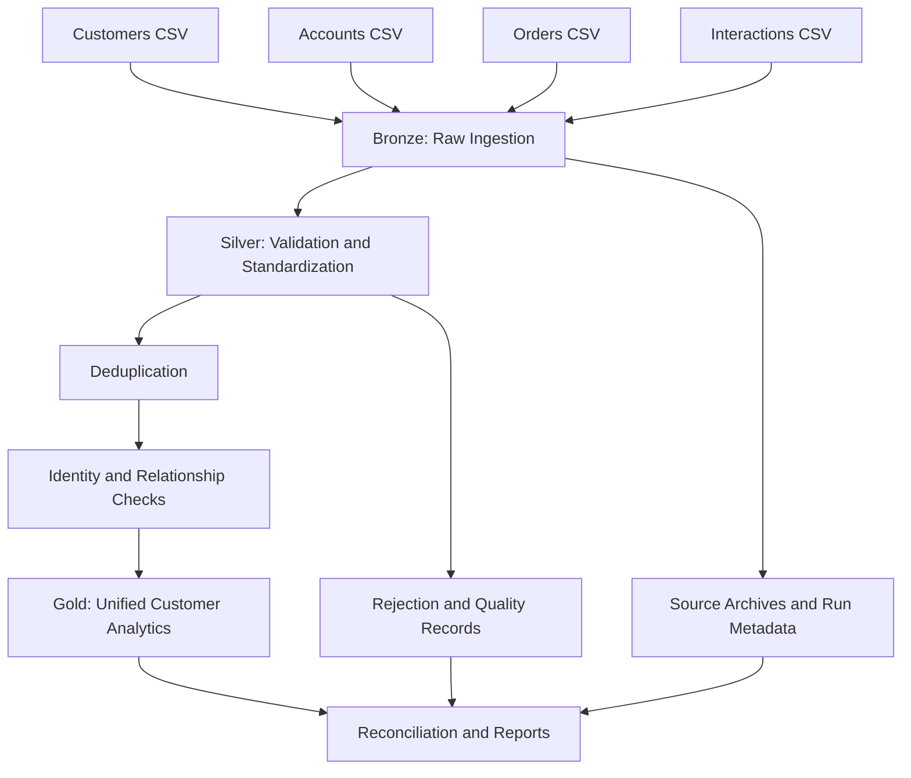

# Unified Customer 360 Platform

**An auditable, reproducible customer data platform that transforms fragmented business records into a unified Customer 360 analytical view.**

Built using Python 3.13, DuckDB, SQL and pytest.

---

## 1. Project Overview

Organizations often maintain customer information across multiple operational systems. Customer profiles, financial accounts, orders and customer interactions may exist in separate datasets, each with its own identifiers, formats, data quality issues and update patterns.

This fragmentation creates several challenges:

- Duplicate customer records across source systems.
- Inconsistent customer attributes and identity information.
- Missing or malformed records.
- Invalid relationships between customers and associated entities.
- Repeated events and duplicate batch ingestion.
- Difficulty tracing analytical records back to their original sources.
- Unreliable reporting when upstream data is incomplete or inconsistent.

The **Unified Customer 360 Platform** addresses these challenges through a local-first analytical data pipeline that consolidates four CSV data sources into a consistent, auditable representation.

The system follows a **Bronze → Silver → Gold Medallion architecture**.

It ingests raw records, validates and standardizes them, resolves deterministic customer identities, checks relationships, manages duplicates and produces analytical datasets suitable for downstream reporting and analysis.

The platform emphasizes data correctness, reproducibility, traceability, safe reruns and failure recovery rather than claiming distributed-scale processing.

### Project objectives

1. Integrate multiple independent business datasets.
2. Preserve original source data for auditability.
3. Validate and standardize incoming records.
4. Detect duplicate and conflicting records.
5. Establish deterministic customer identity relationships.
6. Maintain referential integrity between entities.
7. Support repeatable and idempotent batch execution.
8. Generate trusted analytical outputs.
9. Reconcile input, accepted, skipped and rejected records.
10. Provide measurable execution and benchmark reports.

---

## 2. Data Sources and Business Entities

The pipeline works with four primary CSV datasets.

| Entity | Purpose |
|---|---|
| Customers | Customer profiles and identity attributes |
| Accounts | Financial or service accounts associated with customers |
| Orders | Customer transaction and order records |
| Interactions | Customer engagement and interaction events |

These datasets represent different aspects of a customer's relationship with an organization.

### Unified Customer View

The Gold layer consolidates the customer information and associated business entities into an analytical representation.

This allows downstream consumers to examine customer profiles alongside their related accounts, orders and interactions rather than querying four disconnected raw datasets independently.

The objective is to maintain consistent relationships and traceability across the resulting analytical data.

---

## 3. System Architecture

The platform uses a Medallion architecture with three primary processing layers.

### High-level data flow



### Bronze Layer — Raw Data Ingestion

The Bronze layer acts as the entry point for source data.

Responsibilities include:

- Reading the four source CSV files.
- Preserving original source files through run-specific archives.
- Retaining parsed original row values.
- Recording ingestion metadata and source information.
- Tracking source system and run identifiers.
- Detecting repeated records and previously loaded data.
- Maintaining raw ingestion history.

Original source files are archived under the source-system and run-ID structure.

This creates an auditable relationship between incoming files and their corresponding pipeline execution.

The Bronze layer prioritizes preservation and traceability rather than silently correcting incoming data.

### Silver Layer — Validation and Standardization

The Silver layer transforms raw input into validated and consistent records.

Its responsibilities include:

- Schema and field validation.
- Handling missing required values.
- Detecting malformed records.
- Validating identifiers and relationships.
- Detecting exact duplicates.
- Identifying conflicting duplicate keys.
- Validating amounts and timestamps.
- Checking customer identity consistency.
- Handling out-of-order child events.
- Quarantining invalid or conflicting records.

The layer distinguishes between records that can be safely processed and those that require rejection or further review.

Exact duplicates, previously loaded records and conflicting records are treated separately so that the pipeline can report their outcomes accurately.

### Gold Layer — Unified Customer Analytics

The Gold layer contains the analytical outputs generated from validated Silver data.

It provides the unified customer representation and associated entity-level outputs.

Responsibilities include:

- Consolidating customer information.
- Maintaining relationships between customers and associated entities.
- Producing analytical tables.
- Preserving traceability to upstream records.
- Supporting downstream analytical queries.
- Maintaining consistency across repeated executions.

The Gold layer is published transactionally so that failed publication does not leave partially updated analytical outputs.

---

## 4. Data Quality and Validation

Data quality is treated as a core pipeline responsibility rather than a separate reporting activity.

The platform evaluates incoming records against structural and domain-level rules.

### Validation scenarios

| Scenario | Pipeline behavior |
|---|---|
| Missing required attributes | Reject or quarantine |
| Malformed records | Reject |
| Invalid identifiers | Reject |
| Invalid foreign-key references | Reject |
| Invalid amounts | Reject |
| Invalid timestamps | Reject |
| Exact duplicate records | Count and skip |
| Previously loaded records | Skip safely |
| Conflicting duplicate keys | Reject or quarantine |
| Conflicting customer identity | Manual review |
| Schema drift | Detect and fail the affected run |

### Rejection tracking

Rejected records are accounted for separately from successfully processed records.

The reports include rejection counts and reasons, helping identify recurring data quality problems.

The pipeline does not silently discard invalid data.

---

## 5. Deduplication and Idempotency

A reliable ingestion pipeline must handle repeated data without creating duplicate analytical records.

This project implements separate handling for different duplicate scenarios.

### Within-batch duplicates

When the same record occurs more than once in a single incoming batch, exact repetitions are identified and counted separately.

### Previously loaded records

When a batch is replayed, records that have already been loaded are recognized and skipped.

### Conflicting records

Records sharing a key but containing conflicting content are not treated as harmless duplicates. They are handled as conflicts and rejected or quarantined according to the validation logic.

### Idempotent execution

The pipeline is designed so that replaying an identical input does not create additional Silver or Gold records.

The benchmark validates this behavior by processing identical input twice and comparing:

- Newly inserted records.
- Previously loaded records.
- In-batch duplicates.
- Rejected records.
- Silver and Gold output counts.

This provides an explicit check of repeatability rather than relying only on successful execution.

---

## 6. Identity Resolution

Customer identity is important when combining records from independent systems.

The platform uses deterministic matching based on available identity attributes.

### Matching strategy

- Exact email matching is used where applicable.
- Source-ID fallback provides deterministic identification.
- Conflicting names or email identities are not automatically merged.
- Ambiguous identity conflicts are directed to manual review.

This approach prioritizes predictable behavior and avoids unsafe fuzzy merges.

The objective is to create consistent customer relationships without incorrectly combining different individuals.

---

## 7. Referential Integrity and Reconciliation

A unified analytical platform must preserve valid relationships between its entities.

The pipeline validates relationships between customers, accounts, orders and interactions.

Invalid references are identified before records are included in trusted analytical outputs.

### Row-accounting reconciliation

Every run reports the disposition of incoming records.

For successful batches:

\[
\text{Input Rows} =
\text{Inserted Rows} +
\text{Previously Loaded Rows} +
\text{In-Batch Duplicates} +
\text{Rejected Rows}
\]

The platform also tracks unprocessed records for failure scenarios.

### Reported metrics

- `input_rows`
- `inserted_rows`
- `skipped_existing_rows`
- `skipped_duplicate_batch_rows`
- `rejected_rows`
- `unprocessed_rows`
- `output_rows`

Additional reporting includes:

- Bronze, Silver and Gold record counts.
- Entity-level counts.
- Rejection reasons.
- Stage execution durations.
- Total execution duration.
- Target database size.
- Row-accounting reconciliation.

`output_rows` includes inserted and safely skipped rows, while `accepted_rows` counts newly inserted Silver records.

These distinctions make the reports more useful for understanding what actually happened during a run.

---

## 8. Transaction Management and Failure Recovery

The platform uses DuckDB transactions to protect important processing operations.

### Failure handling

When a pipeline operation fails:

1. The exception is captured.
2. The current pipeline stage is recorded.
3. The transaction is rolled back where applicable.
4. Persisted Bronze counts are evaluated.
5. A failed-run report is written.
6. The database connection is closed safely.

Failed-run reports preserve the failure reason, stage and full exception traceback.

This makes it easier to identify the location and nature of failures during later investigation.

### Recovery behavior

The pipeline includes recovery testing for failed analytical publication.

The tests verify that:

- Failed Silver/Gold operations do not leave partial transactional changes.
- Existing Gold output is preserved during failed republishing.
- A later retry can rebuild the analytical output from preserved Bronze data.

This supports safer execution when an operation fails after raw ingestion.

---

## 9. Reproducible Data Generation

The project includes a configurable data generator for testing different data volumes and data quality scenarios.

### Dataset presets

| Preset | Total rows |
|---|---:|
| Small | 100 |
| Medium | 10,000 |
| Large | 100,000 |

Counts represent total rows across all four CSV files, not customer counts.

The distribution is balanced and recorded in `manifest.json`.

### Generation modes

**Clean mode**

Produces valid and consistent records for baseline testing.

**Messy mode**

Introduces realistic data quality issues while maintaining the requested total row count.

Examples include:

- Missing keys and attributes.
- Exact duplicate records.
- Conflicting duplicate keys.
- Invalid references.
- Invalid amounts and timestamps.
- Conflicting email identity.
- Shuffled and out-of-order child events.

**Schema drift mode**

Produces a deliberately malformed header to test schema validation and failure behavior.

### Reproducibility

The generator supports configurable seeds.

Using the same seed and configuration allows the same dataset to be generated again.

Generation refuses to overwrite existing files unless `--overwrite` is explicitly supplied.

---

## 10. Technology Stack and Design Decisions

| Technology | Role |
|---|---|
| Python 3.13 | Data generation, validation, orchestration and reporting |
| DuckDB | Runtime analytical database |
| SQL | Relational transformations and analytical queries |
| pytest | Unit, integration, recovery and large-dataset tests |
| JSON | Structured run and execution reports |
| Parquet | Optional analytical export and format benchmarking |
| CSV | Input and source-data format |

### Why DuckDB?

DuckDB was selected because it provides an embedded analytical database with SQL support and direct interaction with CSV and Parquet data.

It supports the project's local analytical workload without requiring a separately managed database server.

It also provides a straightforward environment for reproducible execution and benchmarking.

### Why not Polars?

The current transformations are implemented through relational SQL and custom validation logic.

Polars is therefore not required as a runtime dependency.

It can be considered if future benchmarks identify dataframe-oriented operations that would benefit from it.

### Why not Great Expectations?

The project's validation requirements are based on explicit schemas and domain-specific rules.

These checks are implemented directly and covered by tests, so an additional validation framework is not currently necessary.

### Why not Dagster or Prefect?

The current system is a local one-shot batch pipeline.

It does not require a scheduling or orchestration service to execute its defined workflow.

An orchestration framework may become relevant if the platform evolves into a scheduled multi-pipeline environment.

---

## 11. Project Setup

### Requirements

- Python 3.13
- Windows PowerShell or a compatible Python environment

### Create a virtual environment

```powershell
py -3.13 -m venv .venv
```

### Install dependencies

```powershell
.venv\Scripts\python.exe -m pip install -e ".[dev]"
```

All project commands use the local virtual environment interpreter explicitly.

---

## 12. Generate Data

Generate the clean datasets:

```powershell
.venv\Scripts\python.exe generate_data.py --size small --mode clean --out data/generated/small_clean

.venv\Scripts\python.exe generate_data.py --size medium --mode clean --out data/generated/medium_clean

.venv\Scripts\python.exe generate_data.py --size large --mode clean --out data/generated/large_clean
```

Generate a messy 100,000-row dataset:

```powershell
.venv\Scripts\python.exe generate_data.py --size large --mode messy --out data/generated/large_messy
```

Additional options:

- `--total-rows N`: Generate an exact total row count.
- `--seed 314159`: Select a reproducible seed.
- `--mode schema_drift`: Generate a deliberately malformed header.
- `--overwrite`: Explicitly permit overwriting existing generated files.

---

## 13. Run the Pipeline

Example execution:

```powershell
.venv\Scripts\python.exe pipeline.py --input data/generated/small_clean --database database/customer360.duckdb --raw-root data/raw/archive --source-system demo
```

The pipeline processes the supplied source files and writes the resulting data to DuckDB.

Each execution receives a unique JSON report under:

```text
output/duckdb_reports/
```

The reports preserve run-level information and record processing outcomes.

Original source files are archived under the source-system and run-ID structure.

---

## 14. Testing and Verification

The project uses pytest for unit, integration, large-dataset and recovery testing.

Run the full suite:

```powershell
.venv\Scripts\python.exe -m pytest -v
```

Run only the 100,000-row clean integration test:

```powershell
.venv\Scripts\python.exe -m pytest tests/test_pipeline.py::test_large_clean_100k_total -q
```

### Test coverage

The test suite covers:

- Deterministic dataset generation.
- Clean and messy input processing.
- Bronze, Silver and Gold reconciliation.
- Exact batch replay.
- In-batch duplicate handling.
- Cross-run duplicate conflicts.
- Invalid relationships and identity conflicts.
- Schema drift detection.
- Transaction rollback.
- Failed Gold publication.
- Recovery after an injected failure.
- Empty batches and validation helpers.
- Large 100,000-row integration processing.
- Runtime and execution behavior.
- Failure-stage and traceback reporting.

### Latest verified test result

```text
18 passed in 148.99 seconds
```

This result corresponds to the latest full-suite execution after the diagnostic reporting changes.

The 100,000-row benchmark was not rerun after those changes, so no new benchmark result is claimed here.

---

## 15. Performance and Format Benchmarking

The project includes a benchmark command to evaluate pipeline execution and compare CSV and Parquet storage.

Example:

```powershell
.venv\Scripts\python.exe benchmark.py --sizes large --mode messy --seed 1729 --repeats 1 --out data/benchmarks/run_100k
```

### Benchmark workflow

The benchmark:

1. Generates the requested dataset.
2. Records generation time separately.
3. Processes all input through Bronze, Silver and Gold.
4. Checks input, accepted, rejected and duplicate reconciliation.
5. Processes the identical input again.
6. Verifies that previously loaded records are skipped.
7. Checks that duplicate and rejected counts are consistent.
8. Verifies that Gold counts remain unchanged after replay.
9. Measures CSV and Parquet export sizes and write times.
10. Measures full scans, selected-column scans and representative aggregate queries.
11. Records pipeline stage durations, database size and process memory where supported.

### Benchmark metadata

The benchmark report records:

- Operating system and platform.
- Processor and CPU count.
- Python version.
- DuckDB version.
- Dataset size and entity distribution.
- Data generation seed.
- Compression settings.
- Execution samples and medians.

Benchmark results apply only to the machine and dataset sizes tested. They are not evidence of distributed scalability or performance on other hardware.

The benchmark refuses to reuse a non-empty benchmark case directory to protect existing results.

---

## 16. Storage Format Evaluation

CSV and Parquet are compared using data exported from the same DuckDB tables.

The evaluation considers:

| Metric | Purpose |
|---|---|
| File size | Compare storage requirements |
| Write time | Compare export overhead |
| Full scan | Evaluate complete dataset reading |
| Selected-column scan | Evaluate analytical projection |
| Aggregate query | Evaluate representative analytical workloads |

Parquet is treated as an optional analytical output format rather than a duplicate storage layer.

This keeps the primary runtime architecture simple while allowing a measurable comparison between storage formats.

---

## 17. Project Structure

The project is organized around data generation, pipeline execution, database layers, testing and documentation.

```text
Unified Customer 360/
│
├── src/
│   └── ucv/
│       ├── layers/
│       │   ├── bronze.py
│       │   ├── silver.py
│       │   └── gold.py
│       │
│       ├── benchmark.py
│       ├── generator.py
│       ├── pipeline.py
│       ├── quality.py
│       └── schema.py
│
├── tests/
│   └── test_pipeline.py
│
├── data/
│   ├── generated/
│   ├── raw/
│   └── benchmarks/
│
├── docs/
│   ├── architecture.md
│   └── data_dictionary.md
│
├── output/
├── backups/
│   └── legacy_sqlite/
│
├── generate_data.py
├── pipeline.py
├── benchmark.py
├── pyproject.toml
└── README.md
```

*The tree is illustrative; retain the actual repository paths and files when updating this section.*

---

## 18. Migration and Data Preservation

The previous SQLite databases are retained as offline backups under:

```text
backups/legacy_sqlite/
```

The current runtime uses DuckDB and does not import the SQLite module.

The new DuckDB database is built from preserved source CSV files.

The migration does not claim to recreate historical run-history records that existed only in the previous SQLite databases.

Existing source datasets and historical reports remain preserved.

---

## 19. Limitations and Future Scope

### Current limitations

- DuckDB is an embedded analytical database intended here for local analytics and one writer at a time.
- Performance measurements cover only the current machine and tested dataset sizes.
- Raw source archives grow with each ingestion run.
- Identity resolution uses deterministic matching rather than fuzzy auto-merging.
- Ambiguous identity conflicts require manual review.
- The system is designed for reproducible batch execution, not continuous streaming ingestion.
- No distributed processing or multi-node execution is claimed.

### Potential future improvements

- Incremental processing for larger continuously arriving datasets.
- More advanced identity resolution with confidence scoring and human review workflows.
- Scheduled orchestration for recurring batch workloads.
- Additional analytical marts and customer segmentation outputs.
- API access to the unified customer view.
- Dashboard integration for customer analytics and data quality monitoring.
- Expanded observability and operational alerting.
- Evaluation on larger datasets and additional hardware configurations.

These are potential extensions, not features claimed as implemented in the current version.

---

## 20. Conclusion

The Unified Customer 360 Platform demonstrates an end-to-end approach to consolidating fragmented business data into a reliable analytical representation.

Through a Bronze–Silver–Gold architecture, deterministic identity resolution, data validation, deduplication, relationship checks, transactional publishing, reconciliation and failure recovery, the platform focuses on producing trustworthy and auditable outputs.

Its reproducible data generator, automated tests and benchmark workflow provide a way to evaluate correctness and execution behavior under both clean and deliberately messy input conditions.

The project prioritizes **data integrity, traceability, repeatability and maintainability** within a local analytical architecture.

---

**Technology:** Python 3.13 · DuckDB · SQL · pytest · CSV · Parquet
